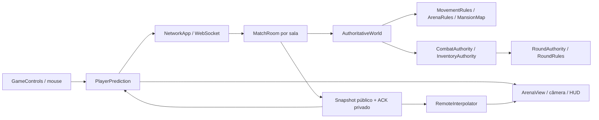

# SPEC 00 — Contratos da arquitetura

> A seção final registra os deltas dos SPECs 01–08. O inventário original abaixo permanece como baseline auditado.

Auditado em 2026-10-21, no commit `dd15ff2ab29d5e67fccedc41c431c30eb7e32c6d`. Este documento descreve comportamento existente; não autoriza mudança de regras ou de protocolo. A Master SPEC v1.0 é direção de trabalho, não prova de que um recurso já existe.

## Composição e limites

`project.godot` abre `shared/network_app.tscn`, nó `NetworkApp` com `shared/network_app.gd`. O mesmo ponto de composição escolhe `server`, `dedicated`, `client`, `menu` ou `demo`. Menus e arena são montados por código; `client/arena_view.tscn` e `client/round_hud.tscn` são cenas pequenas de apresentação. Não existe cena de jogador com controlador `CharacterBody3D`.

`RoundAuthority`, `AuthoritativeWorld`, inventário, combate, registro de corpos e salas são `RefCounted`: não dependem de renderizador nem de cenas físicas. `NetworkApp` concentra RPCs, orquestração, callbacks por sala, comandos de CLI e ganchos de teste. Evitar extrair ou reescrever esse coordenador apenas por tamanho; uma extração futura precisa conservar sua superfície de RPC e os consumidores de teste.

## Interfaces que as etapas seguintes devem preservar

| Responsável | Interface existente | Consumidores e invariantе |
| --- | --- | --- |
| `GameControls` | `ensure()`, `ACTIONS`, `help_rows()` | Arena, menu e ajuda leem o mesmo InputMap. Registro idempotente. |
| `MovementRules` | `validate_input(move, dyaw, dpitch)`, `command_rejection(state, move, dyaw, dpitch)`, `apply_look`, `step_movement(state, move, delta)`, `simulate_command(...)`, `resolve_step(from, step)` | Servidor, previsão, demo e interpolação usam as mesmas regras/colisões. Replay não produz efeitos nem RPC. |
| `NetSync` | `encode_packet(epoch, first_seq, commands)`, `parse_packet(payload)`, `encode_command(...)`, `parse_action(raw)` | Único formato de comandos de rede; nenhuma duração arbitrária ou posição declarada. |
| `AuthoritativeWorld` | `receive_commands(peer_id, payload, now_msec)`, `step(gate, run_action, reject)`, `snapshot()`, `ack_for(peer_id)`, `reset_to_spawn`, `bump_epoch`, `teleport` | `peer_id` vem da conexão. Callbacks de ação executam após mira e antes de movimento. |
| `PlayerPrediction` | `add_look`, `queue_action`, `build_command`, `reconcile(ack, player)`, `presented(fraction, delta)` | `NetworkApp` produz comandos; `ArenaView` apresenta. Nunca reaplicar dano/som/munição no replay. |
| `RemoteInterpolator` | `push(tick, players)`, `advance(delta)`, `sample(peer_id)`, `clear`, `remove` | Único buffer remoto, inclusive para alvo do espectador. Não criar interpolador paralelo no SPEC 07. |
| `RoundAuthority` | `join/leave`, `set_ready`, `tick(now_msec)`, `eliminate_player(peer_id, cause, instigator, now_msec)`, `get_role_for_peer`, `get_spectator_state`, `public_state`, `public_roster`, `get_final_reveal` | Somente servidor decide papéis, vida e vitória. Consultas privadas não são RPCs. |
| `CombatAuthority` | `begin_round`, `request_pickup`, `request_reload`, `request_fire(peer_id, sequence, now_msec)`, `private_state`, `public_pickups` | Recebe intenção já autenticada e estado oficial. Emite mudanças privadas, tiros e eliminações sanitizados. |
| `CombatRules` / `WeaponRules` | `request_shot(peer_id, intent, context, now_msec)`, `validate_definition`, `_apply_server_spread` | `intent` com origem/direção é montado internamente pelo servidor; não é payload livre de RPC. Catálogo é do servidor. |
| `InventoryAuthority` | `pickup`, `start_reload`, `complete_reload`, `get_equipped_definition`, `public_pickups` | Coleta usa posição oficial e distância ≤2 m. Máximo de 512 itens por sessão. Não publicar inventário privado de terceiros. |
| `BodyRegistry` / `BodyRules` | `add`, `public_list`, `clear`, `make`, `sanitize`, `PUBLIC_KEYS` | Um corpo por jogador/rodada; sem colisão ou hitbox; DTO público allowlisted. |
| `RoomRegistry` / `MatchRoom` | `room_of(peer_id)`, `assign/unassign`, `create_room`, `destroy`, `add_member`, `set_ready`, `public_state` | Peer pertence a no máximo uma sala; autoridade completa isolada por sala. Host organiza, não decide gameplay. |
| `ShutdownHandshake` | `begin`, `prepare_token_for`, `accept_ready`, `forget_peer`, `is_complete` | Geração + token por peer; jamais contar confirmação anterior ou de outro remetente. |
| `ArenaView` | `apply_snapshot`, `apply_combat_state`, `set_spectator_target`, `set_player_alive` | Um escritor por transform: raiz/câmera no `_process`; animador só pivôs visuais. |

## Input, física e tempo

- `shared/game_controls.gd`: WASD, E coleta, clique esquerdo tiro, R recarga, Q/E espectador, Esc libera mouse, F10 sai. Mouse relativo é tratado por `NetworkApp`; sensibilidade base `0.0025` rad/pixel, multiplicada pelas preferências. Não há ações salto, sprint ou ADS.
- `MovementRules.MAX_SPEED=5.0` m/s e `ACCELERATION=18.0` m/s². Entrada diagonal precisa ter magnitude ≤1 (com epsilon 0.001); cliente amostra vetor normalizado. Aceleração e frenagem usam `move_toward`.
- Física efetiva segue o padrão Godot de 60 Hz (não há override em `project.godot`). `NetSync.TICK_RATE=60`, comando equivale a `1/60 s`; `_physics_process` chama simulação. Não alterar frequência do motor isoladamente.
- Movimento é plano XZ: `resolve_step` fixa Y em `PLAYER_HEIGHT=1.0`. Não há gravidade, salto, chão variável, rampas, agachamento, colisão jogador/jogador nem rigid bodies autoritativos. Colisão é círculo XZ contra AABBs, resolução por eixo e subpassos ≤0.2 m, índice espacial em baldes de 4 m.
- `MansionMap` é fonte única: cômodos, portas, junções, móveis, spawns e pickups. `ArenaRules.BLOCKERS` deriva paredes, vergas, tetos e móveis. Movimento considera base do volume abaixo de 2 m; hitscan considera volumes 3D completos e piso Y=0.
- Não há collision layers/masks de Godot declaradas no gameplay: colisão/hitscan são analíticos, não `PhysicsDirectSpaceState3D`. Qualquer nova layer não substituirá automaticamente o contrato compartilhado.
- Corpo oficial: raio 0.45 m, altura 2.0 m, centro Y=1.0; olho +0.7 m (Y=1.7). Hitbox de tiro é AABB conservadora 0.9×2.0×0.9, sem headshot; não confundir a mesh de 1.8 m com o corpo oficial.
- Yaw zero aponta -Z, +X leste, +Z sul; pitch positivo olha para cima, limitado a ±75°. Deltas por comando ≤0.35 rad; baldes de mira têm rajada 0.7 rad/eixo e reposição 3 rad/s de tempo simulado.

## Contrato multiplayer (protocolo 11)

Transporte: `WebSocketMultiplayerPeer`, inicializado nos adaptadores `server/websocket_server_transport.gd` e `client/websocket_client_transport.gd`. WebSocket usa TCP; `unreliable_ordered` na declaração RPC não cria perda/reordenação como UDP. `SceneMultiplayer.server_relay=false`. Identidade é `multiplayer.get_remote_sender_id()`, nunca label ou campo do cliente.

| Direção | RPC / formato | Garantia |
| --- | --- | --- |
| Cliente → servidor | `request_join(protocol_version: int, requested_label: String)` reliable | Compatibilidade exige `NetworkConfig.PROTOCOL_VERSION=11`; nome validado/sanitizado; em modo online só entra no hall. |
| Cliente → servidor | `room_create(label)`, `room_join(code, label)`, `room_set_ready(value)` reliable, entrada `Variant` validada | Sala selecionada pelo registro do servidor; não aceitar `room_id`, host ou identidade forjada. |
| Cliente → servidor | `submit_commands(payload)` unreliable_ordered | Array `[epoch, first_seq, commands]`; cada comando `[move_x, move_y, dyaw, dpitch, action]`; action `[]`, `["fire", id]`, `["reload", id]` ou `["pickup", id, pickup_id]`. Tipos/tamanhos exatos; sem origin/direction/target/damage/dt. |
| Servidor → cliente | `world_snapshot({tick, session, players, ack})` unreliable_ordered | `players` contém `{peer_id, position, velocity, yaw, pitch, spawn_index, epoch}`; `ack` privado `{seq, epoch, yaw_tokens, pitch_tokens}`. Tick estritamente crescente e sessão atual. |
| Servidor → cliente | `round_public_state`, `round_roster`, `room_state/room_welcome/room_error` reliable | Estado público e roster allowlisted; aparência cosmética independente de papel; nunca mapa secreto de papéis. |
| Servidor → dono | `round_private_role(round_id, role)`, `combat_private_state`, `round_private_spectator_targets` reliable | Papel só ao próprio participante ACTIVE; combate contém vida/arma/munição/recarga próprios; alvos de espectador só ao eliminado autorizado. |
| Servidor → membros | `combat_public_shot`, `combat_public_elimination`, `pickup_public_state`, `round_body_added`, `round_bodies_state` reliable | Evento público sem alvo secreto, inventário alheio ou papéis. Hit confirm booleano só ao atirador. |
| Servidor → participantes | `round_final_reveal` reliable | Somente ENDED, uma vez por rodada, com resultado e papéis finais allowlisted. |
| Servidor ↔ cliente | `shutdown_prepare(generation, token)` / `shutdown_ready(generation, token)` reliable | Encerramento autorizado pelo servidor/operador, com validação por conexão. |

A superfície inclui RPCs de confirmação e coordenação de testes (`client_test_completed`, `round_role_acknowledged`, `spectator_test_followed`, `spectator_reveal_received`); sua mera existência não permite controle de produção. Modos dedicados recusam flags fora de lista; mutações, atraso artificial e versão simulada exigem debug não exportado onde explicitamente guardados. Não renomear/reordenar RPCs sem avaliar handshake de builds antigas: o histórico no `NetworkConfig` registra dependência dos índices RPC para recusa legível de protocolo 10/11.

### Filas, ACK e apresentação

- Envio de input a cada 2 ticks (30 pacotes/s), imediatamente quando há ação; até 8 comandos/pacote. Pacotes limitados a 60/s com burst16; avanço máximo de sequência64; fila32, alvo3, sobrecarga24; orçamento12 ticks e até4 comandos/tick para recuperação controlada.
- Sem comando na fila não há movimento. Duplicados não reaplicam. `last_resolved` é ACK cumulativo de aplicado/recusado/descartado; `epoch` muda no reset, teleporte ou eliminação para invalidar comandos antigos.
- Snapshot a cada3 ticks (20 Hz), por destinatário. Não incluir ACK de outro peer nem estado de outra sala. `_use_room`, `_enter_sender_room`, `_wire_room` e callbacks adiados precisam conservar contexto da sala.
- `PlayerPrediction` já prevê e reconcilia com replay comum; pending limitado90; amostras de métricas512. Correção de posição pequena a partir0.01 m, salto a partir1 m, amortecimento0.1 s e máximo0.25 s.
- Remotos:32 amostras/peer; atraso base6 ticks (100 ms) + jitter limitado6; extrapolação máxima6 ticks e depois hold. Mudança de epoch limpa histórico; trajetória de apresentação evita cortar quinas. `NetStats` registra percentis de erro, intervalos, pendentes e latências; `TransitionMetrics` mede transições e tick.
- Não existe lag compensation/rewind do alvo. Resultado de tiro usa mundo atual no ponto causal do comando. Teste de atraso de aplicação sobre TCP não valida perda/reordenação UDP real.

## Rodadas, papéis e combate efetivo

`RoundState`: WAITING→COUNTDOWN→ACTIVE→ENDED; COUNTDOWN pode voltar a WAITING, ENDED admite WAITING/COUNTDOWN. Só servidor transiciona. `RoundRules` exige4–8 jogadores, exatamente1 assassino,1 detetive e restantes vítimas, Fisher–Yates com RNG do servidor (injetável em teste). Inocentes vencem se assassino não vive; assassino vence se não há inocente vivo.

Vida é `RoundAuthority.alive[peer_id]: bool` e `CombatAuthority.health` (0–100), com participação e conexão separadas. Não existe enum ALIVE/DOWNED/DEAD/LEFT: equivalentes são alive, pertencimento à rodada e sessão no lobby. Não criar DOWNED por interpretação do SPEC 05/07.

O único catálogo integrado é `common_pistol`: dano34, pente6, reserva máxima18, intervalo400 ms, alcance20 m, recarga1200 ms e spread0. Inventário inicia vazio;8 pistolas e12 caixas de munição (6 balas/caixa) são restauradas a cada rodada. Munição e arma privadas; coleta exige posição oficial ≤2 m e item disponível. Sequência por ação tem avanço máximo64 e limite80 ms; tiro também respeita cadência da arma.

`CombatAuthority.request_fire` calcula olho e direção com posição/yaw/pitch oficiais, valida arma, participante vivo, estado ACTIVE, cadência, munição e recarga. O raio escolhe primeiro contato com piso, blocker ou jogador; dano34 é igual entre papéis. `_apply_damage` não contém punição de detetive nem arma letal especial de assassino. Esses requisitos constam da visão, mas não da implementação atual. `RoundRules.ALLOWED_CAUSES` não inclui `shot`, então a causa interna passada como `shot` é sanitizada para `unknown`; comportamento a registrar, sem alterar no SPEC 00.

Ao eliminar: epoch muda e movimento bloqueia; corpo público sanitizado é criado pelo caminho de combate, espectador recebe somente alvos vivos autorizados. Desconectar vivo não cria corpo por esse caminho. Reset limpa combate/corpos/espectador/reveal e restaura spawns. Online só aceita entrada no lobby/countdown; modo local permite entrada tardia sem participação até próxima rodada. Online exige todos PRONTO, mínimo4, contagem10 s, resultado8 s; local usa5/5 s e início automático.

## Apresentação e runtime

`ArenaView` escreve rig local e câmera uma vez/quadro e avatares remotos pelo interpolador. `CharacterRig` cria pivôs nos GLBs sem ossos; `CharacterAnimator` faz respiração/locomoção pelo deslocamento apresentado, não por inputs. Não há AnimationTree. Arma usa recoil/recarga em `weapon_pivot`; dano usa offsets de projeção da câmera, sem alterar mira oficial. `CombatFx`/`SfxBank` são locais, sons sintetizados e eventos limitados64. Câmera e armas especiais futuras não devem expor papéis ou alterar hitbox por efeitos cosméticos.

Renderer `gl_compatibility` desktop/mobile, WorldEnvironment e materiais StandardMaterial3D, luzes atuais sem sombras. Importar técnicas de renderização de outro motor não torna seus plugins/recursos compatíveis com esse perfil ou WebGL.

Servidor local padrão127.0.0.1:9080; dedicado exige headless, bind padrão0.0.0.0, porta argumento > PORT >9080. `DedicatedConfig` só permite mode/port/bind/shutdown-file, erro de configuração sai2 e runtime1. Salas em memória (padrão12, máximo64);8 membros/sala, carência vazia30 s, lobby ocioso30 min, hall ocioso10 min e handshake dedicado15 s. Reinício perde salas; não há persistência/contas. `deploy/start-server.sh` traduz TERM/INT em shutdown-file e espera encerramento; não presumir que Godot4.4.1 trata SIGTERM de forma graciosa sozinho.

## Gates de compatibilidade antes de qualquer implementação

1. SPEC 01: decidir explicitamente se salto/sprint/rampas são novas regras autorizadas. A física atual fixa Y; trocar por CharacterBody mudaria replay, colisão, mapa, hitbox, snapshot, input e testes. Preservar comportamento padrão até decisão e aprovar migração de protocolo caso payload mude.
2. SPEC 02/07: medir e melhorar `PlayerPrediction`, `RemoteInterpolator`, `AuthoritativeWorld` e `NetSync`; não construir duplicatas. Diferenciar testes de TCP com atraso de uma proposta ENet/UDP separada.
3. SPEC 03/04: estender `WeaponDefinition`/`CombatRules`/`CombatAuthority`; não criar segundo WeaponController. Tratar separadamente regras especiais de papel ausentes e calibração de recoil/spread; servidor escolhe RNG.
4. SPEC 05/06: efeitos visuais não escrevem estado autoritativo. Preservar GL Compatibility, origem/direção oficial e servidor sem nós gráficos. Objetos físicos de gameplay exigem definição explícita de autoridade e teste de replay.
5. SPEC 08: aceitar somente recursos realmente aprovados, sem classificar arma especial, DOWNED ou salto como existentes. Atualizar contratos, todos consumidores, versão do protocolo e testes de incompatibilidade juntos se forem alterados.

## Deltas implementados na missão autônoma

- `MovementConfig`/`default_movement_config.tres` alimentam um snapshot validado de escalares compartilhados no build. Defaults 5/18/18 e simulação planar mantidos; não há escolha de configuração pelo cliente nem handshake novo.
- Reconciliação recusa ACK de época anterior antes de mutar estado; época nova limpa ações e mira pendentes. A fila de teste também aguarda a mesma barreira de elegibilidade dos comandos normais.
- `WeaponCatalog.defaults()` cria definições novas. `CombatAuthority` aceita catálogo/RNG confiáveis opcionais; inventário copia os campos validados. Precisão em movimento, bloom, cap e recuperação são internos ao servidor, zero por padrão na pistola comum. Cone usa amostragem esférica própria, sem seed do cliente.
- `ArenaView` separa o pivô de movimento visual do pivô de recarga/recoil. Redução de movimento, morte e espectador limpam efeitos; preferências são aplicadas ao vivo. Origem/direção oficiais e estados de autoridade não recebem esses offsets.
- Perfis gráficos são preferências locais: baseline preserva originais; low reduz custo de material; high só aplica filtro anisotrópico a materiais com textura albedo. Recursos compartilhados não são mutados. Nenhuma luz, colisão, hitbox ou física autoritativa nova.
- `AuthoritativeWorld.set_telemetry_enabled()` habilita medidas limitadas, desligadas por padrão. `telemetry_snapshot()` retorna cópia de seis campos numéricos/amostras de tamanhos, sem papéis ou inventário. Serialização para estimar bytes Variant ocorre somente após validação estrutural; não mede bytes TCP. `clear()` limpa medidas e rejeições; cada sala conserva seu mundo.
- Protocolo **11**, simulação **60 Hz**, lotes **30 Hz**, snapshots **20 Hz**, limites de fila **32**, pendentes **90**, pacote **8** e orçamento **12** permanecem. Não há novo RPC ou campo em snapshot/ACK público.

A cena `tests/scenes/gameplay_integration.tscn` é exclusivamente de teste. O wrapper exige também transporte real com quatro clientes; campanha reutiliza o harness existente de oito jogadores/três rodadas. Certificação e limitações: [08-certification.md](08-certification.md).
